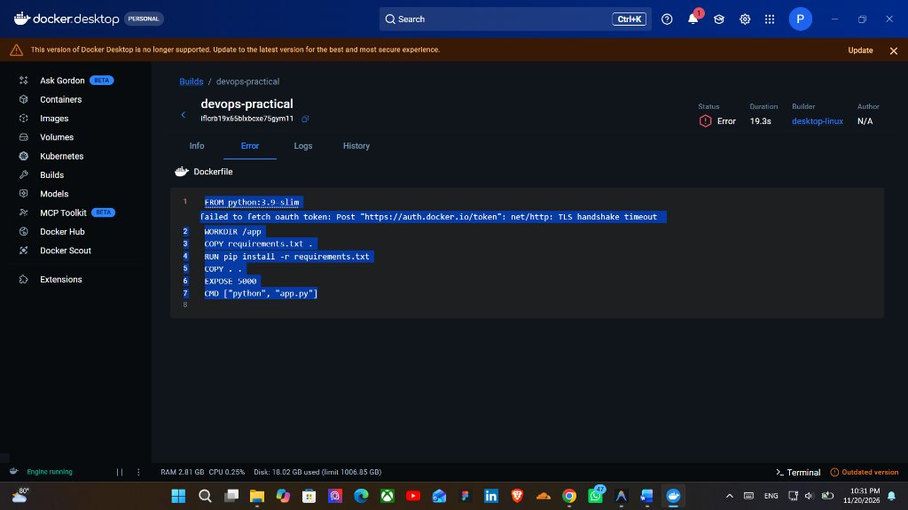
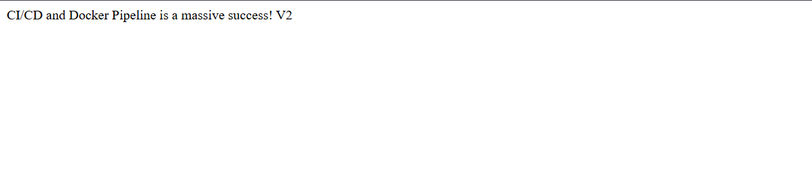

# DevOps Practical Masterclass: End-to-End CI/CD & Cloud Deployment

[](https://github.com/Thiva123-ab/devops-practical/actions)
[](https://devops-practical-mz1w.onrender.com/)

An end-to-end DevOps practical demonstrating modern software delivery practices: **Version Control**, **Shift-Left Automated Testing (CI)**, **Containerization (Docker)**, **Orchestration (Kubernetes)**, and **Continuous Deployment (GitOps/CD)** to the live web.

---

## 🌐 Live Application URL

- **Production URL:** [https://devops-practical-mz1w.onrender.com/](https://devops-practical-mz1w.onrender.com/)
- **Live Output:** `CI/CD and Docker Pipeline is a massive success! V2`

---

## 🛠️ Tech Stack & DevOps Concepts

| Tool / Technology | Role in Pipeline | DevOps Principle |
| :--- | :--- | :--- |
| **Python / Flask** | Microservice Web Application | Application Code |
| **PyTest** | Automated Unit Testing Quality Gate | Shift-Left Quality Assurance |
| **Git & GitHub** | Source Code & Version Management | "Everything as Code" |
| **GitHub Actions** | Automated CI Build & Test Workflow | Continuous Integration (CI) |
| **Docker** | Containerization & Standardized Environment | Immutable Infrastructure |
| **Kubernetes (k8s)** | Pod Deployment & Self-Healing Service | High Availability & Desired State |
| **Render Cloud** | Automated Container Deployment from Git | Continuous Deployment (CD / GitOps) |

---

## 🚀 Practical Implementation Details

### Phase 1: The Foundation (Local Dev & Source Control)
- **Application (`app.py`):** Flask web server responding to root requests with dynamic port binding for cloud compatibility.
- **Automated Quality Gate (`test_app.py`):** PyTest automated unit test testing HTTP response code `200` and verification of output string.
- **Git Repo:** Initialized local Git repository and pushed to GitHub main branch.

### Phase 2: Continuous Integration (GitHub Actions)
- Configured `.github/workflows/ci.yml` pipeline triggering on every `push` to `main`.
- Automated steps:
  1. Checks out repository code.
  2. Sets up Python 3.11 environment.
  3. Installs dependencies from `requirements.txt`.
  4. Runs automated tests via `python -m pytest`.

### Phase 3: Containerization (Docker)
- **Dockerfile:** Standardized multi-stage container specification using `python:3.9-slim`.
- Container tested and verified locally on port `5000:5000`.
- Docker build process verified in Docker Desktop.

### Phase 4: Orchestration (Kubernetes Manifests)
- **`k8s/deployment.yaml`:** Manages 2 desired pod replicas running the Flask container with `imagePullPolicy: IfNotPresent`.
- **`k8s/service.yaml`:** Exposes the pods via a `NodePort` service mapping port 80 to target port 5000.

### Phase 6: Continuous Deployment (Render.com Live Web Service)
- Configured cloud port resolution in `app.py`: `port = int(os.environ.get('PORT', 5000))`
- Connected Render Web Service directly to GitHub repository with Docker runtime.
- **No-Touch Deployment Test:** Updated application response to **V2** and committed to GitHub. GitHub Actions ran the tests, and Render automatically rebuilt and redeployed the live web application without human intervention!

---

## 📸 Screenshots & Evidence

### 1. Docker Desktop & Build Environment


### 2. Live Application Deployment & CI/CD Verification




---

## 🏃 Running Locally

### 1. Run with Python & PyTest
```bash
# Install dependencies
pip install -r requirements.txt

# Run automated tests
python -m pytest

# Start application
python app.py
```

### 2. Run with Docker
```bash
# Build Docker image
docker build -t flask-app:v1 .

# Run container locally
docker run -p 5000:5000 flask-app:v1
```
Open [http://localhost:5000](http://localhost:5000) in your browser.
